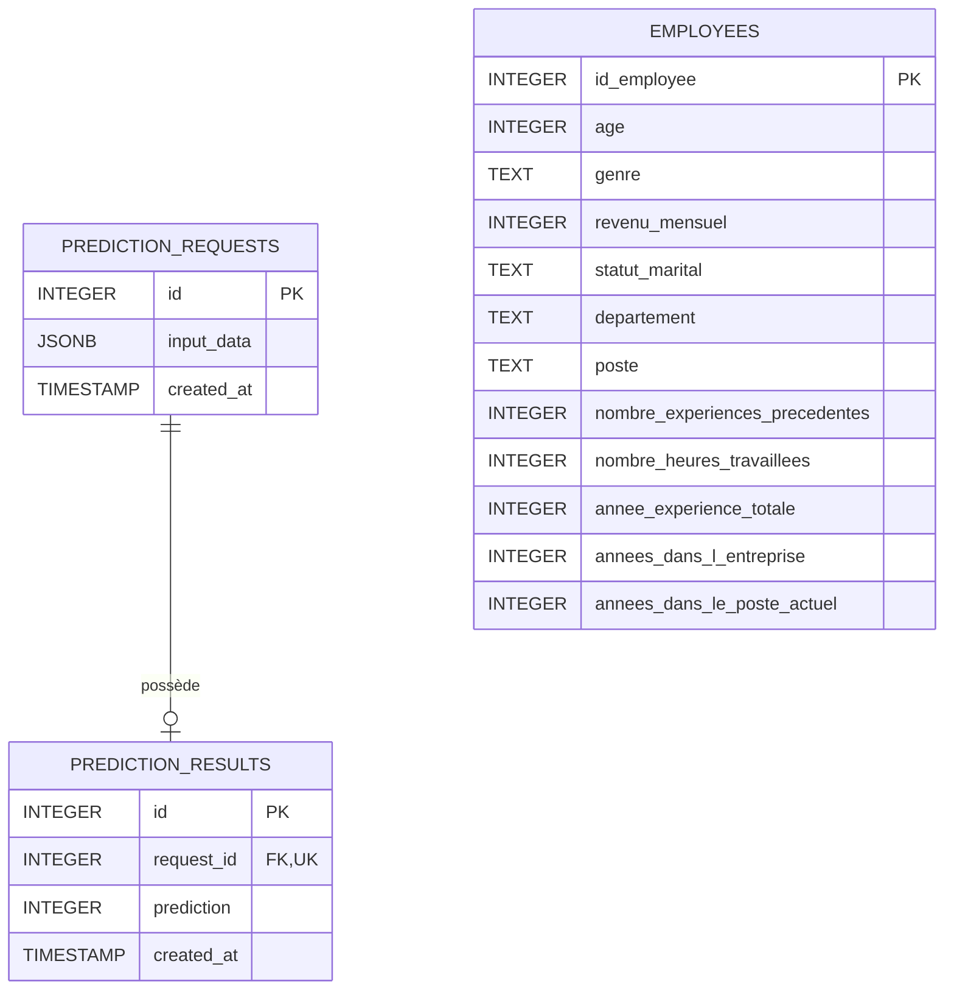

# Schéma de la base de données

## 1. Table `prediction_requests`

Cette table enregistre les données envoyées à l’API pour effectuer une prédiction.

| Colonne | Type | Description |
|---|---|---|
| `id` | INTEGER | Identifiant unique de la demande |
| `input_data` | JSONB | Données transmises au modèle |
| `created_at` | TIMESTAMP | Date et heure de création |

## 2. Table `prediction_results`

Cette table conserve le résultat produit par le modèle.

| Colonne | Type | Description |
|---|---|---|
| `id` | INTEGER | Identifiant unique du résultat |
| `request_id` | INTEGER | Clé étrangère unique référençant la demande associée |
| `prediction` | INTEGER | Prédiction produite par le modèle |
| `created_at` | TIMESTAMP | Date et heure de création |

## 3. Table `employees`

Cette table contient les informations relatives aux employés utilisées dans le projet.

| Colonne | Type | Description |
|---|---|---|
| `id_employee` | INTEGER | Identifiant unique de l'employé (clé primaire) |
| `age` | INTEGER | Âge de l'employé |
| `genre` | TEXT | Genre de l'employé |
| `revenu_mensuel` | INTEGER | Revenu mensuel |
| `statut_marital` | TEXT | Statut marital |
| `departement` | TEXT | Département |
| `poste` | TEXT | Poste occupé |
| `nombre_experiences_precedentes` | INTEGER | Nombre d'expériences précédentes |
| `nombre_heures_travaillees` | INTEGER | Nombre d'heures travaillées |
| `annee_experience_totale` | INTEGER | Années d'expérience totale |
| `annees_dans_l_entreprise` | INTEGER | Années dans l'entreprise |
| `annees_dans_le_poste_actuel` | INTEGER | Années dans le poste actuel |

## 4. Relation entre les tables

La colonne `request_id` de `prediction_results` est une clé étrangère unique qui référence la colonne  `id` de `prediction_requests`.
La contrainte Unique garantit qu'une demande possède au maximum un résultat.

Cette relation permet d'assurer la traçabilité entre les données envoyées à l'API et la prédiction produite.

## 5. Schéma UML de la base de données

