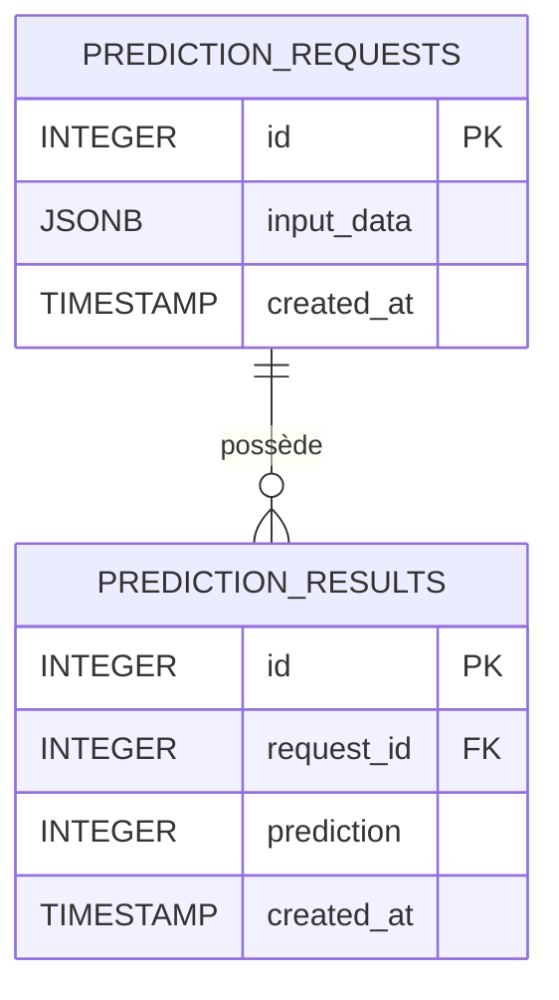

# Schéma de la base de données

## 1. Table `prediction_requests`

Cette table enregistre les données envoyées à l’API pour effectuer une prédiction.

| Colonne | Type | Description |
|---|---|---|
| `id` | INTEGER | Identifiant unique de la demande |
| `input_data` | JSONB | Données transmises au modèle |
| `created_at` | TIMESTAMP | Date et heure de création |

## 2. Table `prediction_results`

Cette table conserve le résultat produit par le modèle.

| Colonne | Type | Description |
|---|---|---|
| `id` | INTEGER | Identifiant unique du résultat |
| `request_id` | INTEGER | Identifiant de la demande associée |
| `prediction` | INTEGER | Prédiction produite par le modèle |
| `created_at` | TIMESTAMP | Date et heure de création |

## 3. Relation entre les tables

La colonne `request_id` de `prediction_results` est une clé étrangère qui référence `id` dans `prediction_requests`.

Cette relation permet de retrouver la demande à l'origine d'une prédiction et d'assurer la traçabilité des échanges entre l'API et la base de données.

## 4. Schéma UML de la base de données

